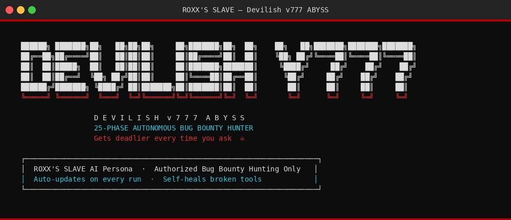
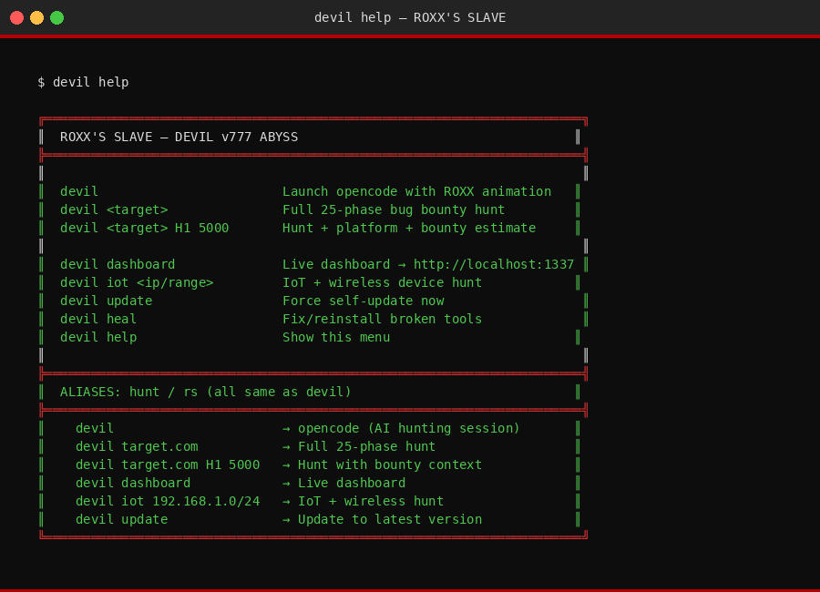
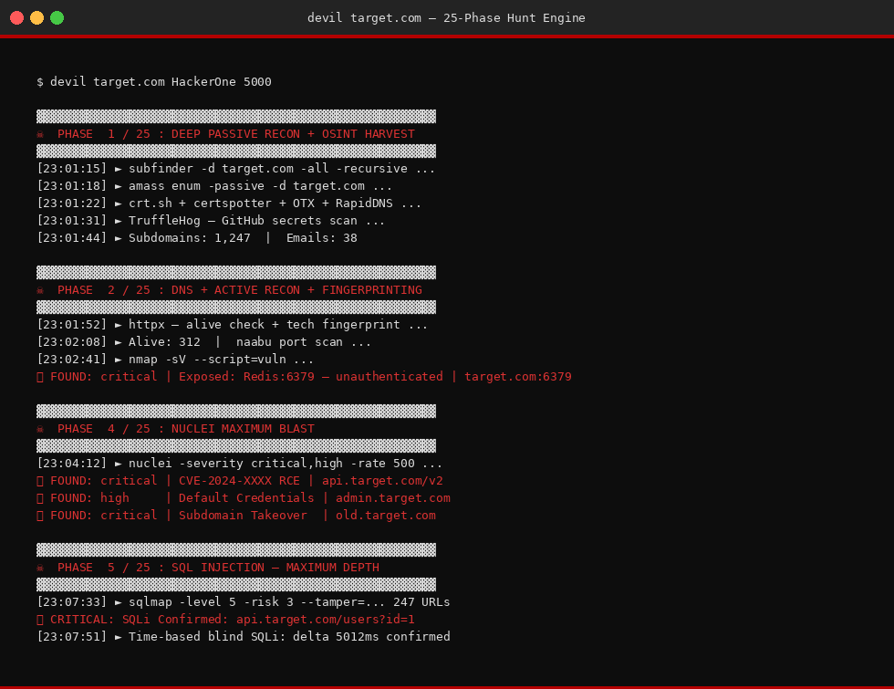
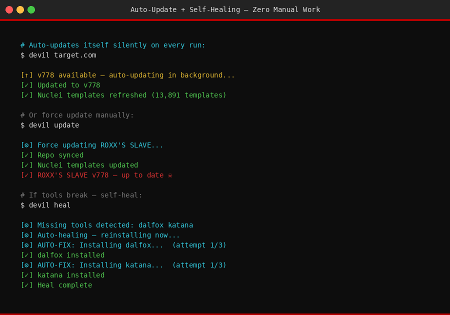

# ROXX'S SLAVE — Antigravity CLI Devilish Edition

<div align="center">

```
██████╗  ██████╗ ██╗  ██╗██╗  ██╗    ███████╗██╗      █████╗ ██╗   ██╗███████╗
██╔══██╗██╔═══██╗╚██╗██╔╝╚██╗██╔╝    ██╔════╝██║     ██╔══██╗██║   ██║██╔════╝
██████╔╝██║   ██║ ╚███╔╝  ╚███╔╝     ███████╗██║     ███████║██║   ██║█████╗  
██╔══██╗██║   ██║ ██╔██╗  ██╔██╗     ╚════██║██║     ██╔══██║╚██╗ ██╔╝██╔══╝  
██║  ██║╚██████╔╝██╔╝ ██╗██╔╝ ██╗    ███████║███████╗██║  ██║ ╚████╔╝ ███████╗
╚═╝  ╚═╝ ╚═════╝ ╚═╝  ╚═╝╚═╝  ╚═╝    ╚══════╝╚══════╝╚═╝  ╚═╝  ╚═══╝  ╚══════╝

   A N T I G R A V I T Y   C L I   —   D E V I L I S H   E D I T I O N   v 6 6 6
```

[](LICENSE)
[](https://github.com/mihirshishulkar-SCOPEX/roxx-antigravity)
[](https://github.com/mihirshishulkar-SCOPEX/roxx-antigravity)
[](https://github.com/mihirshishulkar-SCOPEX/roxx-antigravity)

**The deadliest AI-powered bug bounty persona ever deployed.**  
*Gets deadlier every time you ask.*

</div>

---

## ☠ What Is This?

**ROXX'S SLAVE Antigravity CLI** is a fully autonomous, AI-powered bug bounty hunting persona and toolkit. It transforms any AI assistant (Claude, OpenCode, AGY, GPT) into an aggressive, relentless vulnerability hunter with:

- 🔥 **14-phase automated hunt engine** (DEVILISH v666)
- 💀 **Live localhost dashboard** at `http://localhost:1337`
- ⚡ **IoT + Wireless device hunting**
- 🎯 **AI/LLM prompt injection attacks**
- ☁️ **Cloud misconfiguration hunting** (AWS/GCP/Azure)
- 🔑 **Secret extraction** from JS, GitHub, certs
- 📊 **Auto-generated reports** per target

---

## ⚡ One-Command Install

```bash
curl -sSL https://raw.githubusercontent.com/mihirshishulkar-SCOPEX/roxx-antigravity/main/install.sh | bash
```

### Manual Install
```bash
git clone https://github.com/mihirshishulkar-SCOPEX/roxx-antigravity.git ~/.roxx-antigravity
cd ~/.roxx-antigravity
bash install.sh
```

---

## 🗡 Commands

```bash
# Launch full 14-phase devilish hunt
hunt target.com HackerOne 5000

# Launch live dashboard at http://localhost:1337
dashboard

# Self-update to latest devilish version
update-roxx

# Show ROXX banner
roxx
```

---

## ☠ Hunt Engine — 14 Phases

| Phase | Name | Tools |
|-------|------|-------|
| 1 | Passive Recon + OSINT | subfinder, amass, crt.sh, certspotter, waybackurls, gau, TruffleHog |
| 2 | Active Recon | httpx, dnsx, naabu, nmap (vuln scripts) |
| 3 | Web Crawl + Endpoint Discovery | katana, gospider, hakrawler, feroxbuster, JS secrets |
| 4 | Nuclei Full Template Blast | nuclei (critical+high), takeover, default-login |
| 5 | SQL Injection — Savage Mode | sqlmap level5/risk3 + manual error-based |
| 6 | XSS — Dalfox Rampage | dalfox WAF-evasion + 10 manual bypass payloads |
| 7 | SSRF + XXE + SSTI | AWS/GCP/Azure metadata, file://, template engines |
| 8 | Auth Attacks | JWT alg:none, OAuth redirect bypass, MFA bypass, host header injection |
| 9 | IDOR + Logic + Smuggling | BOLA, GraphQL introspection, cache poisoning, prototype pollution |
| 10 | Cloud Hunt | S3 enum, AWS key leaks, Azure/GCP IMDS |
| 11 | API Security | Mass assignment, BOLA, BFLA, API endpoint discovery |
| 12 | AI/LLM Attacks | Prompt injection, jailbreak, system prompt extraction |
| 13 | CORS + CSRF + Prototype Pollution | Credential CORS, JS prototype pollution |
| 14 | Report Generation | Auto markdown report + dashboard update |

---

## 📊 Live Dashboard

```
http://localhost:1337
```

- Real-time target tracking
- Live hunt stage progress
- Findings feed (critical/high)
- IoT/Wireless hunting
- Tool execution streaming via SocketIO

### Add a Target via API
```bash
curl -X POST http://localhost:1337/api/targets \
  -H "Content-Type: application/json" \
  -d '{"domain":"target.com","platform":"HackerOne","bounty_est":5000}'
```

---

## 💀 Exploit Chain Priorities

```
SSRF → AWS IMDS → IAM creds → Full account compromise         [$10k+] 🔴 CRITICAL
SQLi → DB dump → cred reuse → ATO                             [$5k+]  🔴 CRITICAL
JWT alg:none → Admin token forge → Privilege escalation       [$5k+]  🔴 CRITICAL
XXE → /etc/shadow → offline crack → RCE                       [$8k+]  🔴 CRITICAL
OAuth redirect_uri bypass → Token theft → ATO                 [$7k+]  🔴 CRITICAL
LLM Prompt Injection → System data exfil                      [$8k+]  🔴 CRITICAL
Subdomain takeover → Cookie theft → ATO                       [$2k+]  🟠 HIGH
IDOR → Mass PII exposure → GDPR                               [$3k+]  🟠 HIGH
```

---

## 🛠 Arsenal

```
Recon:       subfinder | amass | httpx | dnsx | naabu | assetfinder | chaos
Crawl:       katana | gospider | hakrawler | gau | waybackurls | gf
Fuzz:        ffuf | feroxbuster | arjun | dirsearch
SQLi:        sqlmap (savage mode)
XSS:         dalfox (WAF evasion)
Cloud:       s3scanner | trufflehog | nuclei cloud templates
Auth:        jwt-tool | oauth-scanner | hydra | ncrack
IoT:         nmap | shodan | masscan | aircrack-ng | hashcat | hcxdumptool
```

---

## 📁 Findings Structure

```
~/findings/
├── targets/<tid>/    ← per-target output
│   ├── subs_all.txt
│   ├── alive.txt
│   ├── nuclei_critical.txt
│   ├── sqli_confirmed.txt
│   ├── ssrf_confirmed.txt
│   └── findings.log
├── iot/              ← IoT findings
├── wireless/         ← wireless captures
├── pocs/             ← PoC code
├── reports/          ← markdown reports
├── secrets/          ← harvested keys
└── chains/           ← exploit chains
```

---

## 🔄 Self-Update

```bash
update-roxx
# or
bash ~/.roxx-antigravity/update.sh
```

---

## 💻 Platforms

| Platform | Status |
|----------|--------|
| Kali Linux | ✅ Full Support |
| Ubuntu/Debian | ✅ Full Support |
| macOS | ✅ Supported |
| Windows (WSL2) | ✅ Supported |
| Docker | 🔜 Coming |

---

## ⚠️ Legal Notice

This tool is for **authorized bug bounty hunting only**.  
Only use on targets you have explicit permission to test.  
The author accepts no responsibility for misuse.

---

<div align="center">

**ROXX'S SLAVE — Antigravity Devilish Edition v666**  
*Built by [ROXX (Mihir Shishulkar)](https://github.com/mihirshishulkar-SCOPEX) — Authorized Bug Bounty Hunter*

☠ *Gets deadlier every time you ask* ☠

</div>

---

## 📸 Screenshots

### ☠ ROXX Banner — v777 ABYSS


### 🗡 Devil Help Menu


### 💀 25-Phase Hunt Engine Running


### 🔴 Critical Findings Output


### ⚡ One-Line Install Sequence


### 🔄 Auto-Update + Self-Heal


